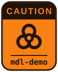

<p align="center">
  
</p>

# mdl-demo

Try Moodle™ or MuTMS on your own computer. One command, no web server,
database or PHP to set up, and no online registration.

mdl-demo is a container image — think of a small computer inside your own,
with its own files and programs, that cannot touch the rest of your machine.
This one has everything a Moodle site needs, plus a web console that sets up
and manages the demo site for you.

## How it works

1. Install container support in your OS — Apple's `container` on
   macOS, Microsoft's `wslc` on Windows, or in a Linux VM.
2. Run one command for your system.
3. Open the console at <http://127.0.0.1:8081>.
4. Pick a Moodle version and click install.
5. A few minutes later your site is ready at <http://127.0.0.1:8082>.

Only your computer can see it. To show it to others, one click in the console
gives it a temporary public link, and another click makes it private again.
Reset the site in the console to start over with a different version, or delete
the container when you are done testing.


## Getting started

### macOS

You need [Apple container](https://github.com/apple/container) (macOS 26 or
newer, Apple silicon). In Terminal:

```sh
container run -d --name mdl-demo-8081 -p 127.0.0.1:8081:8081 -p 127.0.0.1:8082:8082 ghcr.io/mutms/mdl-demo && open http://127.0.0.1:8081
```

For named commands like `create`, `start`, `stop` and `delete`, use the
`mdl-demo` helper described in the **[full macOS guide](MACOS.md)**.

### Windows 11

You need [WSL](https://learn.microsoft.com/en-gb/windows/wsl/) with containers
(`wsl --install --no-distribution` in an administrator Terminal, then restart).
The easiest way in is the **[MDL Demo app](https://github.com/mutms/mdl-demo-win)**,
which creates and manages demos for you. Or, in PowerShell:

```powershell
wslc run -d --name mdl-demo-8081 -p 127.0.0.1:8081:8081 -p 127.0.0.1:8082:8082 ghcr.io/mutms/mdl-demo
```

Then open <http://127.0.0.1:8081>. See the **[full Windows guide](WINDOWS.md)**
for more.

### Linux

Running mdl-demo straight on your Linux workstation with Podman or Docker isn't
recommended — it shares your host kernel, so keep it off the machine with your real work.

But if you are on Linux you already know that — and the container engines all share
pretty much the same `run` command. mdl-demo itself was built entirely inside a throwaway
Linux VM, never on the host — read [DEV.md](DEV.md) for how it was done.

## Updating

New releases bring security fixes, so update when one comes out. Your container
tool keeps the image it already has, and a demo keeps running the image it was
made from. To update, get the new image, then delete the demo and create it
again. The demo site and its data are deleted with it.

On macOS:

```sh
container image pull ghcr.io/mutms/mdl-demo
container stop mdl-demo-8081 && container rm mdl-demo-8081
```

On Windows, in PowerShell:

```powershell
wslc pull ghcr.io/mutms/mdl-demo
wslc stop mdl-demo-8081; wslc rm mdl-demo-8081
```

Then run the command from [Getting started](#getting-started) again.

To install Debian's security fixes without losing the demo, click **Update Debian
Trixie** on the console's Settings page, then stop the container and start it again.
This doesn't update mdl-demo itself, which still needs a new image.

## Sharing your demo

By default only your own computer can reach the site and the console. To let
others in, turn on the **Quick Tunnel** switch in the console: it gives the
site a temporary public link (with a QR code for phones) that anyone can open
until you switch it off. While it is on the site is public, so do not put
anything private in it. The console always stays private to your computer.

## Trying plugins

The demo site is a throwaway, which makes it a good place to try a plugin you
would never install on a live server. The console has two ways in:

* **CAMP** — the Community Archive of Moodle Plugins from
  [camp-registry.org](https://camp-registry.org), baked into the image. Search
  it, check the version and any advisories, and install straight into the demo
  site. No account, no download, nothing to unzip.
* **Add a plugin** — paste the git URL of any plugin repository, including your
  own work in progress or a colleague's branch. It is fetched and installed the
  same way.

Install it, click through it, then reset the site and it is gone.

## CLI console and Claude Code

The **CLI console** tile opens a terminal inside the demo, in its own window. You
are the `www-data` user, the same one the web server runs as, with no root. The
code in `demo/` is read-only; `extrarepos/` is yours to write in. The session keeps
running after you close the window, and the welcome message shows how to start.

It's the easy way to fill a demo with sample data using
[Claude Code](https://code.claude.com/docs), or to reproduce and diagnose a bug. Run
`claude-install`, which installs Claude Code with its official installer along with
Chromium, Node, Python and diagnostic tools, then `claude`, and sign in with your own account. A Claude subscription also lets you run
`claude remote-control` and drive it from claude.ai/code or your phone. Claude Code is
Anthropic's product, under Anthropic's own terms, and mdl-demo doesn't include it.

To add a private plugin, `git clone` it into `extrarepos/x`, then run
`mdl-repo-add x`. To deploy later changes, commit them and run it again.

Your Claude login stays in the demo's home directory, where any PHP code on the
site can read it, including a plugin you are trying out. Run `claude auth logout`
before you try a plugin you don't trust, and before you delete the demo.

Claude Code asks for at least 4 GB of memory, and with less, it and Chromium can slow
down, hang or get killed. `claude-install` warns you if the container has less.

* **macOS:** the limit is set when a demo is created. To raise it, download a backup from
  the console if you want to keep the site, delete the demo, and create it again with
  `--memory 4g`:

  ```sh
  container run -d --memory 4g --name mdl-demo-8081 -p 127.0.0.1:8081:8081 -p 127.0.0.1:8082:8082 ghcr.io/mutms/mdl-demo && open http://127.0.0.1:8081
  ```

* **Windows:** memory is shared by all your WSL containers. Run `wslc settings` and set
  `memorySize` under `session`, as Microsoft's
  [WSL container settings](https://learn.microsoft.com/en-us/windows/wsl/wsl-container-settings)
  page explains.

Reset and restore end the terminal session but keep your files. Backups contain only
the site, so they don't include `extrarepos/`, a plugin added from it, or your login.

To let Claude Code edit Moodle and its plugins directly, for example to fix a bug in
core, add `-e MDL_DEMO_EDITABLE_CODE=1` when you create the demo. Things may break, and
resetting the site gives you a clean copy. Backups don't include your code changes, so
a restore loses them unless they are pushed and in the recipe. Any PHP on the site can
change the code too. It can't be switched on later without creating the demo again.

```sh
container run -d --memory 4g -e MDL_DEMO_EDITABLE_CODE=1 --name mdl-demo-8081 -p 127.0.0.1:8081:8081 -p 127.0.0.1:8082:8082 ghcr.io/mutms/mdl-demo && open http://127.0.0.1:8081
```

```powershell
wslc run -d -e MDL_DEMO_EDITABLE_CODE=1 --name mdl-demo-8081 -p 127.0.0.1:8081:8081 -p 127.0.0.1:8082:8082 ghcr.io/mutms/mdl-demo
```

To build a demo without the terminal, set `MDL_DEMO_NO_CLI=1` when you create it.

## Community

Questions, ideas, or just to show what you demoed: join
**[#mdl-demo:matrix.org](https://matrix.to/#/#mdl-demo:matrix.org)** on Matrix.
Bugs and feature requests go to
[GitHub issues](https://github.com/mutms/mdl-demo/issues).

## Contributing

Forks and contributions are welcome. See [CONTRIBUTING.md](CONTRIBUTING.md);
AI assistants can start with [AGENTS.md](AGENTS.md).

## AI disclosure

Most of this project was written with the help of Claude (Anthropic). A human
maintainer reviewed, corrected and accepted everything before it was committed.
The design decisions and the final code are the maintainers' own.

## License

Copyright (C) 2026 Petr Skoda. [GPL-3.0](LICENSE) or later.

Moodle™ is a registered trademark of Moodle Pty Ltd. MuTMS is an independent
project not affiliated with or endorsed by Moodle Pty Ltd.
